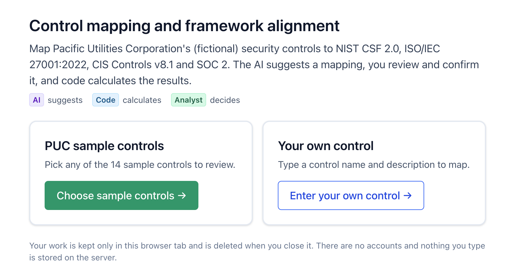
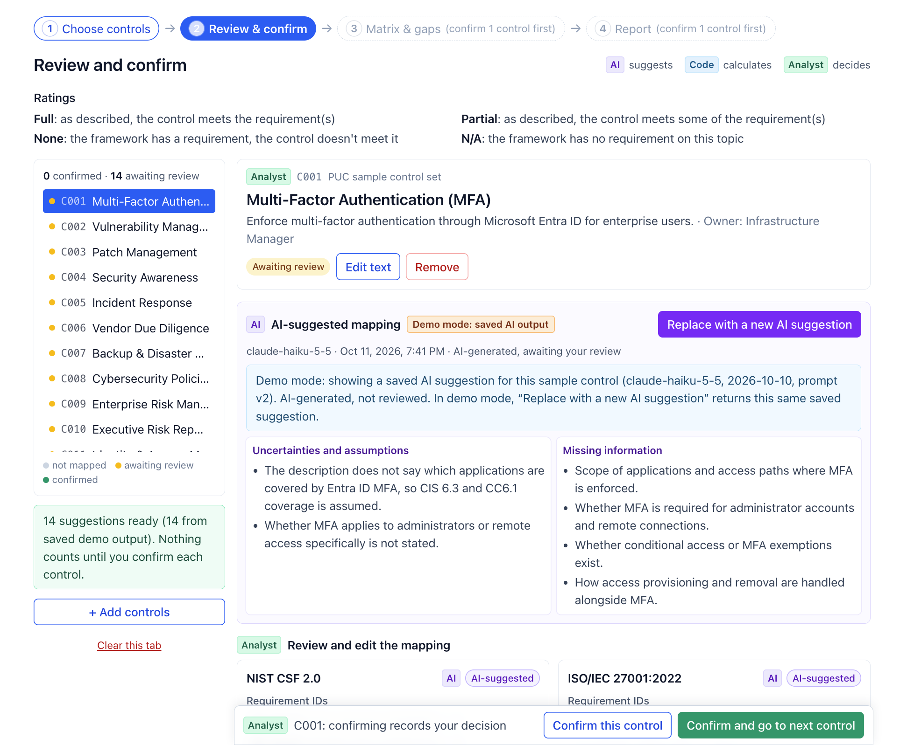
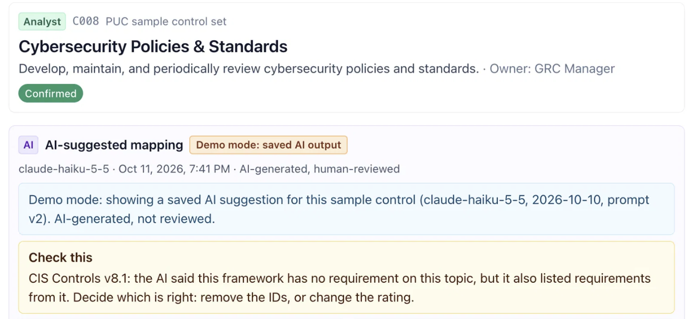
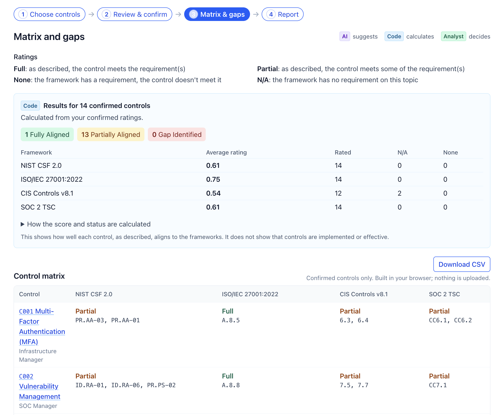
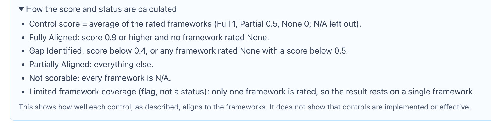
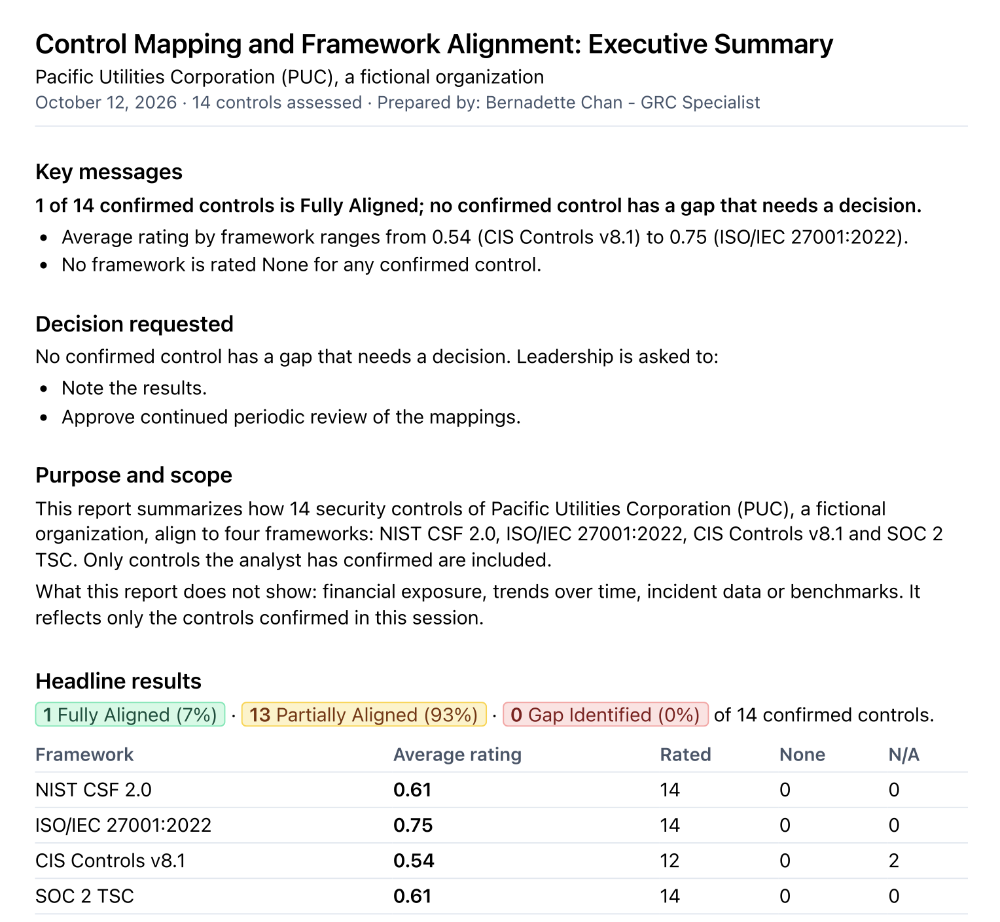
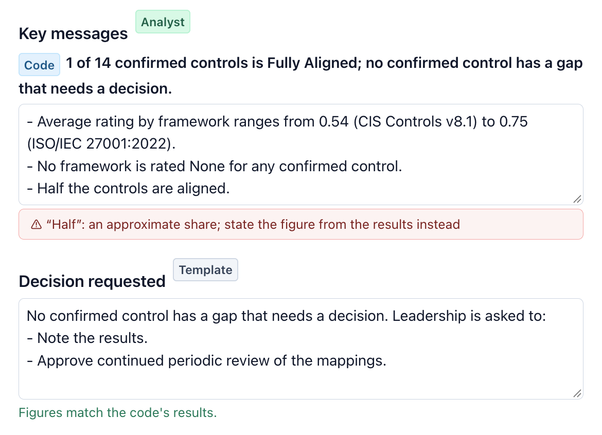

# Control Crosswalk

*An AI-assisted control crosswalk for GRC analysts, designed so the analyst stays in charge.*

Where can AI take the lookup work out of control mapping, and where does a person still have to decide?

Mapping an internal control to NIST, ISO, CIS and SOC 2 means looking up each framework, finding the requirements that apply and copying the result into a spreadsheet. I wanted to see how much of that an AI could do, and what a workflow needs around it so the result can be trusted and traced.

Control intake → AI-suggested mapping → analyst review → analyst confirmation → deterministic scoring → matrix and gaps → executive report

> This is a workflow and governance prototype, not a commercial GRC platform or an enterprise-ready product.

**Live demo:** https://crosswalk-pi-sable.vercel.app/

The demo uses a fictional company, Pacific Utilities Corporation (PUC), and 14 sample controls, with AI suggestions saved from a real run. Nothing you enter is stored on a server.

\* Marked items are planned for a second version. See [What I'd build next](#what-id-build-next).

*The page says who does what: AI suggests, deterministic logic calculates, the analyst decides.*

## What this demonstrates

- Control mapping across NIST CSF 2.0, ISO/IEC 27001:2022 Annex A, CIS Controls v8.1 and the SOC 2 Trust Services Criteria, down to requirement IDs (for example PR.AA-03, A.8.5, 6.3 and CC6.1)
- Framework alignment ratings with a written rationale, and gap analysis
- Traceability designed in from the start, so an auditor asking for evidence can see who decided what and what changed
- Responsible AI use: deciding what to give to deterministic logic, a person and AI (human-in-the-loop design)
- Knowing what a mapping doesn't prove: alignment as described isn't evidence that a control is implemented or operating effectively
- UX design: a clear flow, color-coded results, a CSV export and a PDF report

**A two-minute path:** choose a sample control, review the AI suggestion, change one rating, confirm it, then open the matrix and the report.

## Where AI helps, and where it stops

AI handles the lookup. It shouldn't decide whether a control meets a requirement.

**AI suggests:**
- A rating and a short rationale for each of the four frameworks
- The requirement IDs the control relates to

**The analyst decides:**
- The final rating for each framework, or that a framework doesn't apply
- Whether each control is confirmed, one at a time
- Whether the report is ready to approve

**Deterministic logic calculates:**
- Control scores and status
- The matrix, the gaps list and the CSV
- Every number in the report, and the checks on the report text

Deterministic logic means fixed rules: the same ratings always produce the same results. In the app it appears as the Code badge.

AI suggestions stay advisory. Only confirmed controls count toward results.

*The AI's suggestion, the analyst's edits and the calculated result are kept separate on purpose.*

### A real example of the guardrails

In the saved AI run, control C008 (Cybersecurity Policies and Standards) came back with CIS Controls rated N/A, meaning no requirement on this topic. It also listed a CIS requirement, 3.1, and its own rationale said 3.1 "was not used". The app flagged the contradiction and blocked confirmation until it was resolved. The analyst removed the ID and kept N/A, and the app kept the AI's original suggestion next to the change.

*The app flags an AI answer that contradicts itself.*

## How it works

1. **Choose controls.\*** Pick from the 14 sample controls or enter your own.
2. **Review the AI-suggested mapping.\*** Each framework gets a rating (Full, Partial, None, or N/A with a reason) and a rationale. The analyst can edit any of it.
3. **Confirm one control at a time.** A control counts only after it's confirmed.
4. **Analyze the matrix and gaps.** Deterministic logic scores each control and builds the matrix and gaps list. The CSV export carries the results into the spreadsheets teams already use for mapping.
5. **Review the executive report.\*** The analyst edits the draft, checks run on what's written, and a named "Prepared by" is required before approval, so every approved report has an accountable owner. Then save it as a PDF.

*Every score and status is calculated from the ratings the analyst confirmed.*

**Scoring:** Full scores 1, Partial 0.5 and None 0. N/A (the framework has no requirement on the topic) is left out of the score and needs a reason. None (the framework has a requirement the control doesn't meet) scores 0 and can drive a gap.

*The scoring rules are written down in the app and fixed in code.*

## Executive reporting\*

A report to leadership can sound more certain than the evidence is, so facts and narrative are kept apart.

- **Facts come from deterministic logic,** built from confirmed controls only.
- **The narrative is a template draft,** labelled "Template draft, not AI", which the analyst edits.
- **A number check blocks approval** if the text contains a figure that doesn't match the results.
- **A claim-word check warns** on words like "implemented", "effective" or "compliant", which a mapping exercise doesn't prove.
- **The report states what it doesn't show:** financial exposure, trends over time, incident data and benchmarks.

I used AI where review is easy (the mapping) and deterministic logic where a wrong number does the most damage (the report).

*Facts come from deterministic logic. The narrative is a draft the analyst edits and approves.*

*A figure that doesn't match the results is flagged, and the report can't be approved until it's fixed.*

## Architecture, governance and prototype scope

### How it's built

- Next.js 16, React 19, TypeScript and Tailwind, deployed on Vercel. A type check, tests, catalog validation and a build run on every change.
- AI calls go through a server route using claude-haiku-5-5, with the API key kept server-side. Responses are strict JSON, framework IDs are checked against the reference catalogs, the analyst's text is treated as data, and per-visitor and daily limits apply.
- There are no accounts or database. Work stays in the current browser tab and is deleted when it closes.

I built it with Claude Code and the Claude API, approving its actions as it worked, which mirrors the human-in-the-loop design in the app.

### Demo mode and sample data

The public site runs in demo mode, with saved AI output from a real run (claude-haiku-5-5, 2026-10-10, prompt v2) labelled "AI-generated, not reviewed". Demo mode makes no API calls, so it can't run up costs. The code supports live calls with a server-side key, and a labelled mock mapper (not AI) can be switched on in settings. Keys are never committed. With a live API key, the text of a control is sent to Anthropic's API to generate a suggestion. The public demo makes no API calls and sends nothing.

Pacific Utilities Corporation is fictional, and the 14 controls are my own writing. The AI suggestions are saved from a real run, and I reviewed the sample mappings. I corrected four of them (C002 for NIST, and C006, C012 and C013 for SOC 2), and each correction is recorded in `data/sample-corrections.json`.

### Framework references

Requirement IDs and short labels refer to NIST CSF 2.0, ISO/IEC 27001:2022 Annex A, CIS Controls v8.1 and the SOC 2 Trust Services Criteria. CIS Controls content is licensed by CIS under [CC BY-NC-ND 4.0](https://creativecommons.org/licenses/by-nc-nd/4.0/). NIST CSF 2.0 is a NIST publication. The ISO, SOC 2 and CIS labels are my own paraphrases. No framework source documents are included in this repo, and the project is not affiliated with or endorsed by these organizations.

### Six governance principles

1. **Human-Owned GRC Logic.** The AI proposes and the analyst decides. The scoring rules are fixed and visible in the app.
2. **Human Approval Before Authoritative Records.** Controls count only once confirmed. A report needs a clean number check and a named preparer.
3. **Traceability and Auditability.** Each control keeps its change history and the AI's original suggestion. This is for the current tab only, not a durable audit trail.
4. **Transparency About Uncertainty.** AI output and template text are labelled, N/A needs a reason, and the report states what it doesn't show.
5. **Deterministic Over Generative Where Possible.** Scores, the matrix, gaps, the CSV and every number in the report come from deterministic logic.
6. **Data Minimization by Design.** No accounts, database or saved sessions. Nothing is stored on the server.

### Intentional prototype boundaries

These are part of the design scope: no authentication or role enforcement, enterprise database, durable persistence, production audit history, integrations, organizational taxonomies, tenant model or production hardening. The four frameworks are fixed, which is a simplification, since organizations usually choose two or three. An enterprise version could build on a GRC platform such as ServiceNow IRM. It isn't integrated here.

## What I'd build next

These are the features I moved to a second version to keep the first one finished.

- **An AI-drafted report narrative.** It would see only the facts from deterministic logic, every figure would have to pass the number check, and the template draft would stay as the fallback.
- **Framework selection per assessment,** since organizations usually map to two or three frameworks.
- **A common-controls library,** so one control maps to many requirements once.
- **A preview before replacing an AI suggestion,** so the analyst sees what would change first.
- **A side-by-side view of the AI suggestion and the analyst's decision.**

## Closing reflection

The biggest lesson was trade-offs. The features that defend the core idea went into the first version, and the nice-to-haves moved to the next. Deciding what to leave out was part of the design.

What stayed in is what I set out to show: AI can take on the lookup, and a workflow with the right checks keeps the result traceable and the decision with the analyst. I'm pleased to have it working from intake to report, and version two has a clear place to start.
